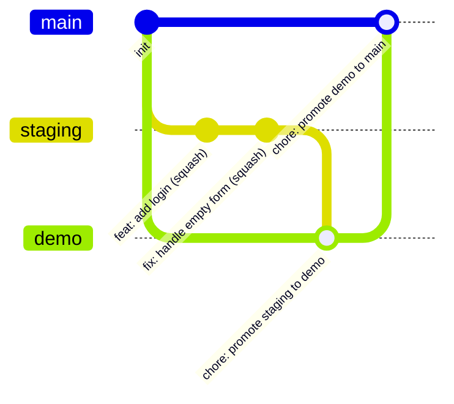

# tanstack-monorepo-template

[](https://github.com/azurioh/tanstack-monorepo-template/actions/workflows/ci.yml)
[](./LICENSE)

A GitHub template for TypeScript monorepos whose web apps run on TanStack Start. It ships the
foundation every project needs before the first feature: workspace layout, strict quality gates,
Conventional Commits, automated releases and dependency updates, branch protection as code, and a
set of Architecture Decision Records that explain every choice.

## Why

Starting a project usually means a day of wiring linters, hooks, CI, branch rules and release
tooling, then re-arguing the same decisions in the next project. This template makes those
decisions once, writes them down, and lets a new repository be protected and green within minutes
of being created.

## What's included

- **Monorepo**: pnpm 12 workspaces and Turborepo 2, `apps/` for deployable units and `packages/`
  for shared code under the `@repo/*` scope.
- **Runtime and language**: Node.js 24 LTS (pinned in `.node-version`), TypeScript 7 (native) in
  strict mode with a shared `@repo/tsconfig` package.
- **Quality gates**: Biome 2 (lint and format for TypeScript, JSON and Markdown), `tsc` type
  checking, Vitest 5, knip 6. Zero errors and zero warnings, locally and in CI.
- **Git hooks**: Lefthook runs Biome on staged files and commitlint (Conventional Commits) on each
  commit, installed automatically by `pnpm install`.
- **CI**: GitHub Actions running `pnpm check` and validating pull request titles; every action is
  pinned to a commit SHA.
- **Releases**: release-please (manifest mode) opens release pull requests with a generated
  changelog on `main`.
- **Dependency updates**: Dependabot, grouped and targeting `staging`, with exact version pins.
- **Repository rules as code**: rulesets for `staging`, `demo` and `main` in `.github/rulesets/`,
  applied with one script along with merge settings, description, topics and private
  vulnerability reporting.
- **Open-source files**: license, contributing guide, code of conduct, security policy, issue
  forms, pull request template, code owners.
- **Architecture Decision Records**: [docs/adr](./docs/adr/README.md).

The starter app (`apps/web`, TanStack Start with Tailwind CSS and shadcn/ui) arrives in spec 2.
A project generator, anti-drift CI and container deployment (Docker, GHCR, Dokploy) arrive in
spec 3. Until then `apps/` is empty and `packages/example` is a placeholder that exercises every
task.

## Quick start

Prerequisites: Node.js 24 (see `.node-version`) with Corepack enabled (`corepack enable`), the
GitHub CLI (`gh`) authenticated with admin rights on the new repository, and `jq`.
1. **Create a repository from the template**: click **Use this template** on GitHub, or run
   `gh repo create <owner>/<name> --public --template azurioh/tanstack-monorepo-template --clone`.
2. **Configure the repository** (first step after creating it, GitHub does not copy settings from
   a template):

   ```bash
   scripts/setup-repo.sh            # add --dry-run to preview every API call
   ```

   It creates the `staging` and `demo` branches, applies the rulesets, sets merge settings,
   description and topics (from `.github/repository.json`), allows GitHub Actions to open pull
   requests and enables private vulnerability reporting. It is safe to run again. Options:
   `--repo <owner/name>` to target another repository, `--template` to mark it as a template.
3. **Install dependencies** (also installs the git hooks):

   ```bash
   pnpm install
   ```

4. **Run the full suite**, exactly as CI does:

   ```bash
   pnpm check
   ```

## Scripts

| Script           | What it does                                                               |
| ---------------- | -------------------------------------------------------------------------- |
| `pnpm check`     | Full suite, same as CI: `turbo run lint typecheck test knip`               |
| `pnpm lint`      | Biome lint and format check over the whole repository, warnings are errors |
| `pnpm format`    | Biome safe fixes and formatting, written to disk                           |
| `pnpm typecheck` | `tsc --noEmit` on root configuration files (packages have their own)       |
| `pnpm knip`      | Unused files, exports and dependencies across the workspace                |

Each workspace package defines `typecheck` and `test` (and `build` when it emits output);
`pnpm check` runs them through Turborepo with caching.

## Structure

```text
.
├── apps/                      # deployable apps (starter app in spec 2)
├── packages/
│   ├── tsconfig/              # @repo/tsconfig: shared strict TypeScript configuration
│   └── example/               # @repo/example: placeholder package with a test
├── docs/adr/                  # Architecture Decision Records and their index
├── scripts/setup-repo.sh      # one-shot repository configuration
├── .github/
│   ├── actions/setup/         # composite action: pnpm, Node.js, install
│   ├── workflows/             # CI and release-please
│   ├── rulesets/              # branch rulesets for staging, demo, main
│   ├── ISSUE_TEMPLATE/        # bug report and feature request forms
│   ├── repository.json        # description and topics applied by setup-repo.sh
│   ├── dependabot.yml
│   ├── CODEOWNERS
│   └── pull_request_template.md
├── biome.jsonc · turbo.json · knip.json · lefthook.yml · commitlint.config.ts · tsconfig.json
├── release-please-config.json · .release-please-manifest.json
├── package.json · pnpm-workspace.yaml · pnpm-lock.yaml · .npmrc · .node-version
└── README.md · LICENSE · CONTRIBUTING.md · CODE_OF_CONDUCT.md · SECURITY.md
```

## Branch flow

Feature branches are squash-merged into `staging`. Promotions to `demo` and then `main` use merge
commits, so every feature commit reaches `main` unchanged and release-please lists each one in the
changelog. Details and rationale: [ADR 0006](./docs/adr/0006-branch-flow-and-repository-rules.md).



- Every pull request targets `staging`, and its title must be a Conventional Commit.
- Direct pushes, force pushes and branch deletion are blocked on all three branches, for
  administrators too.
- Merging requires the `check` and `pr-title` status checks to pass.

## Personal tooling

Two directories hold the maintainer's personal development tooling. They are not used by the
build, the tests or CI, and are excluded from Biome:
- `.specify/` and `specs/`: [GitHub Spec Kit](https://github.com/github/spec-kit) configuration and
  the specifications this template was built from.
- `.claude/`: Claude Code agent configuration.

To remove them from a project created from the template:

```bash
rm -rf .specify specs .claude
```

Then drop the matching `!!.specify`, `!!specs` and `!!.claude` entries from `files.includes` in
`biome.jsonc` and run `pnpm check`.

## Learn more

- [Contributing guide](./CONTRIBUTING.md)
- [Architecture Decision Records](./docs/adr/README.md)
- [Security policy](./SECURITY.md)
- [Code of conduct](./CODE_OF_CONDUCT.md)

## License

[MIT](./LICENSE)
